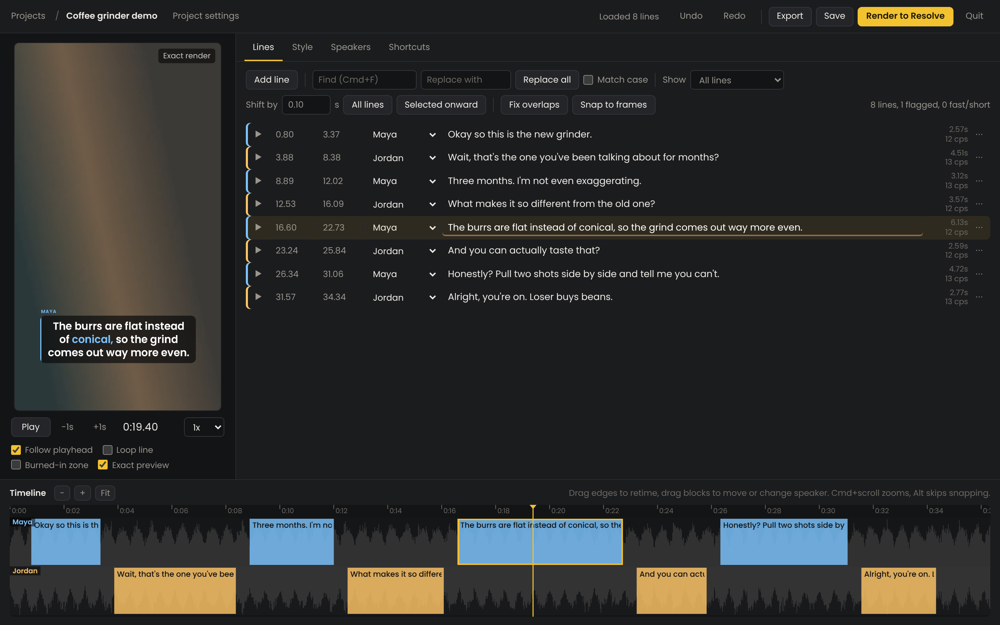

# davinci-subtitles

Per speaker captions for short form video. Whisper transcript, speaker split, a local editor
to fix it all up, and a ProRes 4444 overlay that drops straight onto a DaVinci Resolve timeline.

I built this because the caption tools I tried either couldnt tell two people apart, or made
me fix every line in a tiny box inside Resolve. This does the boring 90% on its own and gives
you a proper editor for the rest.



## What it does

- **Transcribes locally** with Whisper large v3 on Apple Silicon (mlx), word level timestamps,
  plus an optional second pass on words it wasnt sure about.
- **Splits by speaker** with pyannote segmentation + TitaNet embeddings (sherpa-onnx). Every
  sentence gets one speaker by vote, and it only splits mid sentence when diarization is sure.
  There's an extra pass for people far from the mic.
- **Builds caption lines** that respect a max length and on screen time, and flags the lines
  it wasnt confident about so you know where to look.
- **Editor** in the browser: line list, waveform timeline with drag to retime, drag captions on
  the video to place them, find / replace, undo, per speaker overrides, presets, and a pixel
  exact preview from the same renderer that makes the final file.
- **Renders** a 1080x1920 ProRes 4444 with alpha and swaps it into Resolve for you, or imports
  it into a Captions bin and puts it on a new top track.
- **Exports** SRT (combined, plain and per speaker), VTT, ASS and a plain transcript.


## Setup

Needs an Apple Silicon Mac for transcription (mlx-whisper). The editor, renderer and exporters
run anywhere with Python 3.11+ and ffmpeg.

```
git clone https://github.com/tristedw/tristedw-davinci-subtitles
cd tristedw-davinci-subtitles
./scripts/setup.sh
```

That makes `.venv`, installs the deps, installs ffmpeg through Homebrew if it's missing and
downloads the two speaker models into `.models/sherpa`. Whisper weights download themselves
the first time you transcribe.

```
.venv/bin/python -m subtitles          # http://localhost:8765
.venv/bin/python -m subtitles.demo     # sample project, no whisper needed
./scripts/make-app.sh                  # Subtitles.app you can keep in the dock
```

For **Render to Resolve** turn on Preferences > System > General > External scripting using
in Resolve and keep a project open.

## Using it

**New project** (Cmd+N): pick a video file, a clip from your open Resolve timeline, or the whole
timeline (it renders a light copy of your edit first so captions match the cut). Say how many
people talk or leave it on Auto, give their names in the order they first talk, and add any
names or slang Whisper should spell right. It runs in the background and opens the editor when
it's done.

In the editor:

- **Lines**: text, timing and speaker per line. `Show: Flagged` lists the lines to double check.
- **Timeline**: drag edges to retime, drag blocks to move them or change speaker.
- **Style**: font, outline, shadow, box, name tag, position, animation, word highlight and timing
  rules. Save the ones you like as presets in `presets/`.
- **Speakers**: rename, recolor, per person font / color / size, and **Merge into** when auto
  detection split one voice into two.
- **Project settings**: relink a moved video, set the Resolve clip name, or rebuild the lines,
  the speakers or the whole transcript. Rebuilds keep the old version in `.history/`.

The Shortcuts tab has every key.

## Config

| env var | default | |
| --- | --- | --- |
| `SUBS_PROJECTS` | `./projects` | where projects live |
| `SUBS_PORT` | `8765` | editor port |
| `SUBS_SYNC` | `auto` | git sync for the projects folder: `auto`, `on`, `off` |

Projects are never committed to this repo. If you want them backed up or shared between
machines, make the projects folder its own **private** repo with a remote. With `SUBS_SYNC=auto`
the app pulls it on start and commits + pushes about 20s after each save.

```
projects/<name>/
  project.json         name, source video, clip name, transcribe settings
  captions_edit.json   lines, words, speakers, style
  work/                audio, whisper + diarization output, poster
  renders/ export/ .history/
```

## How it works

```
subtitles/
  server.py          http server + json api for both pages, job runner, git sync
  pipeline.py        video -> captions_edit.json, runs as a subprocess and reports progress
  render.py          pillow renderer, used for the exact preview and the final prores
  exporters.py       srt / vtt / ass / txt
  resolve_bridge.py  talks to Resolve through its scripting api
  demo.py            sample project
web/
  home.html          project list + new project flow
  editor.html        the editor
  app.css            shared tokens and controls
```

The pipeline steps, in order. Each one caches its output in `work/` so rebuilds only redo what
they need (`python -m subtitles.pipeline projects/<name> --from speakers`).

| step | what |
| --- | --- |
| resolve | timeline projects only: render a light h264 of the edit out of Resolve |
| probe, audio | ffprobe, 16k mono + a loudness normed copy |
| transcribe | whisper large v3 (turbo on Fast), word timestamps, spelling hints as the prompt |
| refine | Best only: redo segments with very low confidence words, keep whichever pass is surer |
| speakers | pyannote seg 3.0 + titanet, fixed cluster count if you gave one |
| quiet | optional: whisper on each speaker turn of the normed audio |
| lines | sentences get one speaker by vote, split only where diarization is sure, wrap to max chars |

The Resolve scripting module only loads in some Python builds, so `resolve_bridge.py` runs
small snippets in whichever system Python can import it instead of the venv.

The server only answers localhost and rejects requests from other origins, so a random web
page cant poke at your files through it.

## Dev

```
pip install -r requirements-dev.txt
ruff check .
pytest
```

CI runs both on every push. Transcription isnt tested in CI since it needs Apple Silicon.

## License

MIT. Bundled fonts are from Google Fonts under the SIL Open Font License, see `fonts/README.md`.
